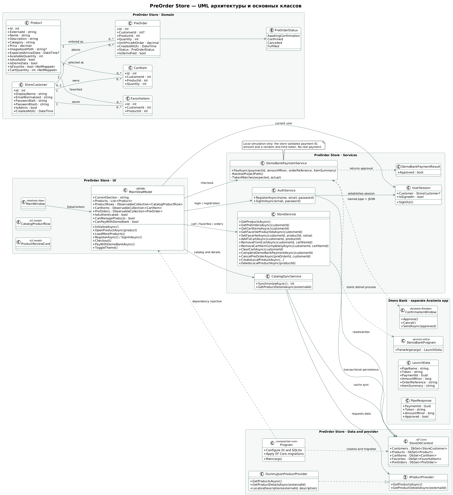
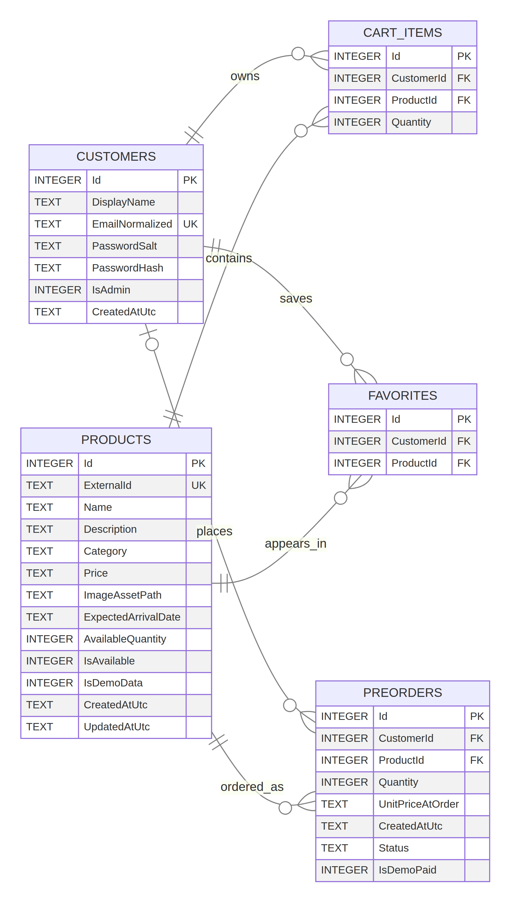

# Архитектура, база данных и защита проекта

Эта папка содержит материалы для изучения архитектуры и подготовки к защите курсовой.

## UML-диаграмма приложения

Диаграмма показывает UI/MVVM, сервисы, провайдер DummyJSON, контекст EF Core, доменные классы и отдельное приложение Demo Bank с локальным named-pipe обменом.

Исходник: [PlantUML](diagrams/Архитектура_PreOrder_Store.puml).

## Схема SQLite

В схеме перечислены все пять таблиц текущей модели: `Customers`, `Products`, `CartItems`, `Favorites`, `PreOrders`.

Исходник: [Mermaid ER diagram](diagrams/Схема_базы_данных.mmd).

### Ограничения и типы данных

- `Products.ExternalId` и `Customers.EmailNormalized` уникальны.
- Пары `CartItems(CustomerId, ProductId)` и `Favorites(CustomerId, ProductId)` уникальны.
- Количество в `CartItems` и `PreOrders` должно быть больше нуля.
- Удаление покупателя каскадно удаляет его корзину и избранное. Товар нельзя удалить, если он используется корзиной или предзаказом; удаление товара удаляет связанные отметки избранного.
- Необязательные поля: `Products.ImageAssetPath`, `Products.ExpectedArrivalDate` и `PreOrders.CustomerId`.
- `PreOrders.CustomerId` допускает `NULL` для совместимости с внутренним сервисным сценарием; обычное оформление через интерфейс требует входа.
- Отдельной таблицы платежей нет: в `PreOrders` хранится флаг `IsDemoPaid`, а `UnitPriceAtOrder` фиксирует цену на момент оформления.
- В модели EF цена имеет точность 12,2. SQLite provider сериализует decimal как `TEXT`, а булевы значения — как `INTEGER`.

## Подготовка к защите

- [Памятка: назначение модулей, запуск, показ и ответы](Памятка_защиты.md)
- [Аудиообъяснение проекта](audio/Объяснение_курсовой_PreOrder_Store.mp3)
- [Текст аудио](Аудио_скрипт.md)
